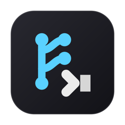
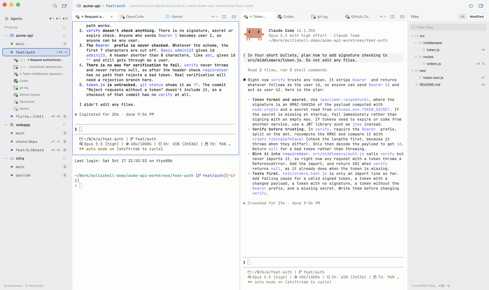
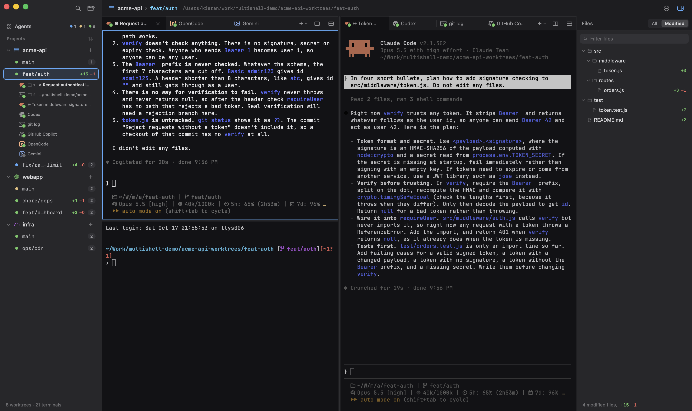

<p align="center">
  
</p>

<h1 align="center">Multishell</h1>

<p align="center">
  A native macOS terminal for running coding agents across many git worktrees at once.
</p>

<p align="center">
  Your projects sit in a sidebar with every worktree under them. Pick one and its tabs, splits and agents fill the window.<br>
  Switch away and they keep running; a dot on each tab and row tells you which agents are working, waiting on you, or done.
</p>

<p align="center">
  
  &nbsp;&nbsp;
  
</p>

## Install

There is no notarised release yet, so you build it from source. You need:

- macOS 26 Tahoe or later
- Xcode 26 or later (Swift 6.2), not only the command line tools
- the Zig version Ghostty pins, `zig@0.16` today
- `git` on your `PATH`

Set up the toolchain once, and again after each Xcode update. Skip
`xcode-select` if Xcode is already the active developer directory:

```sh
brew install zig@0.16                          # Scripts/build-ghostty.sh --zig-version names the version
sudo xcode-select -s /Applications/Xcode.app
sudo xcodebuild -license
sudo xcodebuild -runFirstLaunch
xcodebuild -downloadComponent MetalToolchain
```

Then clone, build and install into `/Applications`. `make signing-identity` is
once per machine; its local certificate keeps the permissions you grant across
rebuilds.

```sh
git clone https://github.com/KieranP/multishell.git
cd multishell
make signing-identity
make install
```

The first build compiles libghostty from the `ThirdParty/ghostty` submodule,
which takes a minute or two. Open Multishell and add a repository with the
folder button at the top of the sidebar, or Cmd+O.

`make run` builds and opens a debug copy with its own state, so it can run
beside the installed one. If a build fails after a pull that moved files, run
`make clean` once. If it stops because the submodule is past its pin, run
`git submodule update ThirdParty/ghostty`. The full build notes are in
[Docs/develop/build.md](Docs/develop/build.md).

### Agent hooks

zsh, bash and fish report their state with no setup. Agents report through their
own hooks, so the dots and the Agents board stay still until you add them: open
Settings > Agents > Hooks and click Add beside each agent. Multishell adds its
entries to the agent's config, keeping a copy of the file the first time, or
writes a file of its own; Remove takes out only what it added. Codex then asks
you to trust the new hooks once, with `/hooks`. [COMPAT.md](COMPAT.md) lists
every file it touches and how far each shell and agent goes.

## Features

**Worktrees**

- Every project in one sidebar, each with its own symbol and colour, every
  worktree under it, bare clones included.
- A new branch and worktree in one step, with a shell or agent already running
  in it.
- `.env`, `node_modules` and the like copied or symlinked into each new
  worktree.
- Pre and post hooks for create and remove, shareable with your team in
  `.multishell.json`.
- Rows show lines added and removed, ahead and behind, and a badge once the
  branch has landed; sort, filter and rename them.
- Removing a worktree moves it to the Trash, or deletes it if you prefer.

**Terminals**

- Tabs, splits and side-by-side tab groups per worktree.
- Terminals keep running while you look at another worktree, and a tab dragged
  to another worktree moves without restarting.
- libghostty draws the terminals. Themes colour the whole window: Multishell's
  light and dark, ten editor ports such as Dracula, Nord and Catppuccin, and
  your own in JSON.
- Find in a pane with Cmd+F, and click in the prompt to move the cursor there.
- Drop files from Finder onto a terminal as `@` mentions or quoted paths.
- Open the worktree in your editor.
- Your shell rc files are never edited.

**Files**

- A Files panel beside the tabs lists every file in the worktree, ignored ones
  greyed, or only what changed. Open it from View > Files Panel, or click a
  row's line-count badge.
- Files open read-only in tabs beside the terminals, with uncommitted changes
  against `HEAD` shown unified or side by side, syntax highlighting and Cmd+F.

**Agents**

- Claude Code, Codex, Gemini CLI, Copilot CLI and OpenCode, each with its own
  icon on its tab.
- A state dot per tab and worktree: working, waiting on you, done or failed.
- An Agents board of every running agent, a chip counting the subagents and
  background shells each has out, and a Dock badge for the ones waiting.
- Your preferred agent one shortcut away, with its flags set globally or per
  project.
- Notifications for tabs you are not looking at, toggled per state.
- Saved agent tabs resume their session on the next launch.

**Scripting**

- A `multishell` command that drives the app: projects, worktrees, tabs, panes
  and settings, reading and waiting on a pane, and screenshots.
  `multishell help` lists it all. Multishell's own terminals have it on their
  `PATH`; Install Command Line Tool under Settings > Agents > Hooks links it
  into `/usr/local/bin` for other terminals.
- `multishell state` lets any script or shell set its tab's dot.
- View > Enable Debug Tools shows frame rate, CPU, memory and git timings.

## Status

- Source builds only; no notarised release yet.
- macOS 26 and later, built and run on Apple silicon. Intel is untested.
- English only.

Every line of code was written by an AI (Claude), directed by a human who set
the requirements and reviewed the results in the running app. The design
decisions under `Docs/design/` were argued out in that conversation; the
architecture, the trade-offs and what shipped were human calls.

## Contributing

Start with [AGENTS.md](AGENTS.md), which indexes `Docs/develop/` for the build,
tests and rules, and `Docs/design/` for why things are the way they are. Pull
requests are from collaborators only, as [CONTRIBUTING.md](CONTRIBUTING.md)
explains. Issues are open to anyone. Report a vulnerability through
[SECURITY.md](SECURITY.md) instead of an issue.

## License

Copyright (C) 2026 Kieran Pilkington. GNU Affero General Public License v3.0;
see [LICENSE](LICENSE). Third party notices are in
[THIRD-PARTY-NOTICES.md](THIRD-PARTY-NOTICES.md).
